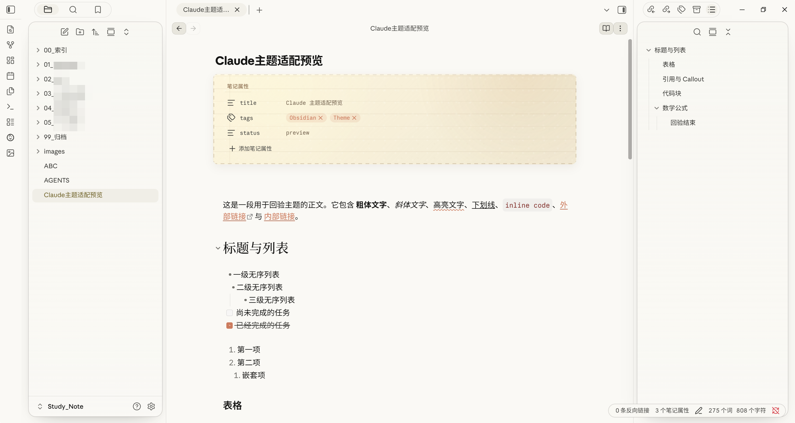

# 🍵 Claude Washi for Obsidian

**Claude Washi** 是一款面向长篇阅读、深度研读与技术写作的沉浸式 Obsidian 主题。
融合了 **Anthropic Claude Desktop** 的现代桌面端质感与 **Typora Claude** 的经典和纸（Washi Paper）文稿美学，辅以标志性的 **赤陶色（Terracotta #D97757）** 与克制优雅的微动效。

---

---

## ✨ 核心特性

### 🍵 1. 和纸手账质感 YAML / Properties 属性卡片
- **针脚缝线边框**：利用四向重复渐变模拟手账纸张边缘微距缝线针脚。
- **纸张微纤维漫反射**：浅色与深色模式分别配备噪点滤镜层（`soft-light` / `screen`），呈现温润的书卷触感。
- **清晰属性层次**：大写微字距属性标题、柔和赤陶多选胶囊，编辑聚焦时仅保留 2px 优雅左强调线。

### ⌨️ 2. 3D 立体拟物 `<kbd>` 快捷键键帽
- 专为软件操作手册、快捷键指南设计的实体机械键帽质感。
- 亮色下配备顶层光泽微白渐变与底边沉降投影；暗色下采用沉稳内凹微阴影，排版自带防折行保护。

### 🌸 3. 深色模式暖杏粉加粗（Bold Color Shift）
- 暗色模式下加粗文字（`**粗体**`）与表格表头自动映射为柔和暖杏粉（`#E6987D`），告别暗底纯白文字的生硬刺眼，久读不累。

### 〰️ 4. 克制优雅的波浪线下划线高亮
- `==高亮文本==` 采用透明底色 + 赤陶色波浪下划线，配置 `text-decoration-skip-ink: none`，确保遇到 `g`、`p`、`y`、`j` 等下沉字符时波浪线不被截断。

### 📂 5. 目录栏悬停平滑右移（Slide-on-hover）
- 鼠标划过侧边栏文件、文件夹或大纲目录时，文字带 `0.22s` 贝塞尔弹性向右平移 `4px`，提供丝滑跟手的微交互。

### 💨 6. 120ms 贝塞尔弹出微动效
- 右键菜单、快捷输入提示（`.suggestion-container`）与页面浮窗预览拥有细腻的弹出微缩放，并完整支持 `prefers-reduced-motion` 无障碍抑制。

### 🖥️ 7. 现代桌面端与插件深度兼容
- **Windows 无边框标题栏融合**：顶部悬浮胶囊与原生窗口最小化/最大化/关闭按钮完美避让与对齐。
- **虚拟滚动兼容**：CM6 编辑器虚拟滚动适配，代码块圆角标题栏与语言标签自适应。
- **Style Settings 插件支持**：支持自由调节正文宽度、字号、行高、段落间距、字重及强调色。
- **Code Styler 插件联动**：智能识别 Code Styler 状态，无缝对齐色彩变量。

---

## 📦 安装方法

### 方法一：使用 BRAT 插件（推荐）
1. 在 Obsidian 中安装并启用 **BRAT** 社区插件。
2. 打开 BRAT 设置，点击 **Add Beta Theme**。
3. 输入 GitHub 仓库地址：`xisdumpling/Claude-Washi`。
4. 点击 **Add Theme** 并启用。

### 方法二：手动安装
1. 前往 [Releases](https://github.com/xisdumpling/Claude-Washi/releases) 页面下载最新发布的 `Claude-Washi.zip`（或 `manifest.json` 和 `theme.css`）。
2. 将解压出的文件夹放置于你的 Obsidian 仓库目录：`.obsidian/themes/Claude Washi/`。
3. 打开 Obsidian **设置 → 外观 → 主题**，选择 **`Claude Washi`**。

---

## 🎨 Style Settings 支持项

若已安装 **Style Settings** 插件，可在设置中自由定制：
- **字体与排版**：正文最大宽度（默认 752px）、字号、行高、段落间距。
- **字重微调**：界面字重、浅色/深色模式正文字重、粗体字重、代码字重。
- **色彩与强调色**：Claude 标志赤陶色、深色模式粗体强调色自定义。

---

## 📄 开源许可

本项目基于 [MIT License](LICENSE) 开源。

